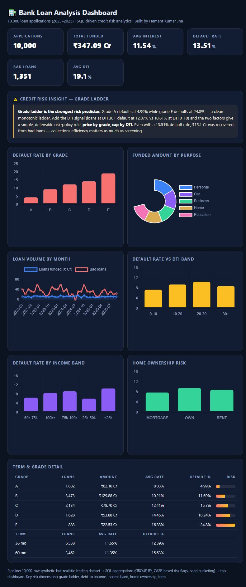

# 🏦 Bank Loan Analysis Dashboard

**Business question:** *Which loans are most likely to default, and what lending policy would cut that risk?*



## ▸ Project Highlights

▸
Analysed 10,000 loan applications (₹347.09 Cr funded) across grade, purpose, DTI, income band, home ownership and term to profile default risk.
▸
Proved the credit-grade ladder is the strongest risk predictor — defaults climb monotonically from 4.99% (Grade A) to 24.8% (Grade E).
▸
Quantified secondary risk signals: 60-month loans default at 15.63% vs 12.39% for 36-month; DTI 20-30 band defaults at 15.38% vs 10.61% at DTI 0-10.
▸
Built a defensible risk-policy rule — *price by grade, cap by DTI* — and showed ₹15.1 Cr was recovered from 1,351 bad loans (13.51% portfolio default rate).

## 📁 Repo Structure

```
├── data/
│   ├── data.csv          # 10,000 loan records (synthetic, deterministic)
│   └── data.db           # SQLite database (load-and-query ready)
├── sql/
│   └── queries.sql       # 10 annotated analytical queries
└── dashboard/
    ├── index.html        # Interactive dashboard (Chart.js, no build step)
    ├── agg_data.json     # Pre-computed aggregates feeding the dashboard
    └── screenshot.jpg
```

## 🚀 How to Run

1. **Dashboard:** open `dashboard/index.html` in any browser — no server, no install.
2. **SQL:** open `data/data.db` with any SQLite client (or `sqlite3 data/data.db`) and run `sql/queries.sql`.

## 🔍 Key SQL (risk ladder)

```sql
SELECT grade, COUNT(*) loans,
       ROUND(100.0*SUM(CASE WHEN status IN ('Charged Off','Default')
              THEN 1 ELSE 0 END)/COUNT(*),2) default_rate
FROM loans GROUP BY grade ORDER BY grade;
```

| Grade | Loans | Default % |
|---|---|---|
| A | 1,882 | 4.99% |
| B | 3,473 | 11.69% |
| C | 2,134 | 15.7% |
| D | 1,628 | 18.24% |
| E | 883 | 24.8% |

## 💡 Analytical Takeaways

1. **Grade ladder works** — a clean monotonic relationship; pricing should follow it mechanically.
2. **Longer terms are riskier** — 60-month books carry +3.2 pts of default vs 36-month; term premium should be explicit, not baked in.
3. **DTI adds independent signal** — combine both and a risk officer gets a simple two-factor policy: price by grade, cap by DTI.
4. **Collections matter** — ₹15.1 Cr recovered from bad loans shows recovery efficiency is as material as screening.

---

*Dataset is synthetic and generated deterministically for portfolio demonstration. All figures are computed from the data via the SQL in `sql/queries.sql`.*

**Built by Hemant Kumar Jha** · Data Analyst · SQL · Python · Dashboards
